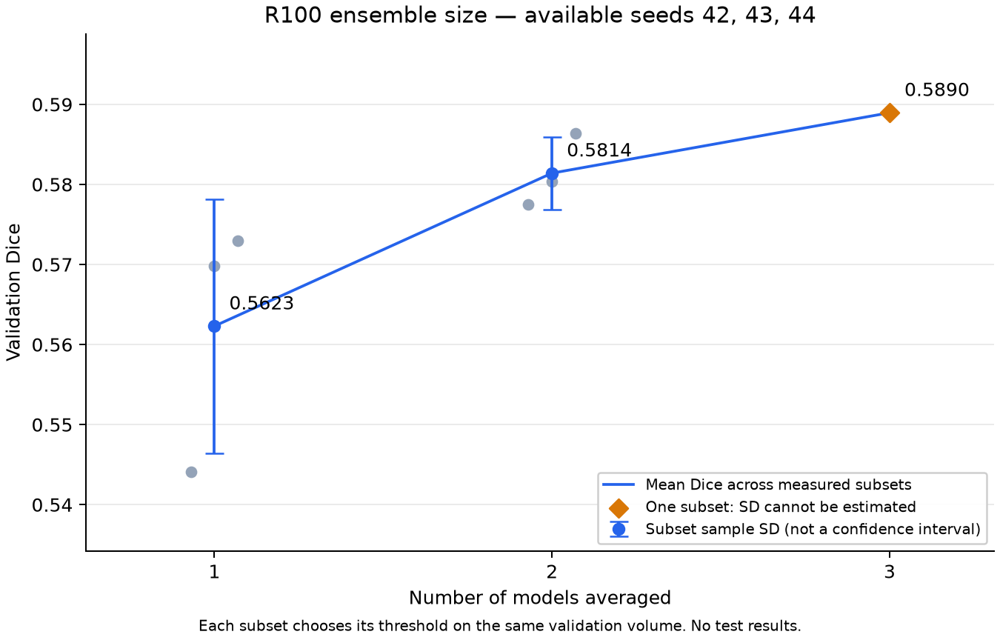

# R100 validation ensemble-size measurement

Available clean seeds: 42, 43, 44.

This is a validation-only measurement. Every combination selects its own threshold on the same full validation data it scores. These are apparent validation scores, not held-out performance estimates.

| Models averaged | Subsets measured | Mean validation Dice | Subset sample SD | Min | Max |
|---:|---:|---:|---:|---:|---:|
| 1 | 3 | 0.562302 | 0.015865 | 0.544072 | 0.572980 |
| 2 | 3 | 0.581409 | 0.004551 | 0.577464 | 0.586388 |
| 3 | 1 | 0.588951 | not estimable (one subset) | 0.588951 | 0.588951 |

Subset SD describes sensitivity to which models are selected from this finite pool. Combinations share models and are correlated; the bars are not confidence intervals across new surveys or newly trained seed pools. A single full-pool ensemble does not establish zero uncertainty.

This result is conditional on the 3 available seeds. It cannot establish performance at larger sizes than that pool. Three seeds alone cannot establish saturation at eight, ten, or forty.

The analysis reads FP32 cached probabilities and labels; it performs arithmetic and histogram scoring, without neural-network inference, training, or opening Thebe HDF5 files. No test evaluation occurs.

Keep flip TTA, alternative losses, overlap inference, and checkpoint/weight averaging in separately named experiments. They change factors beyond seed count.

[Study explanation and next-stage plan](../../experiments/R100_SEED_SATURATION_20261019.md).
