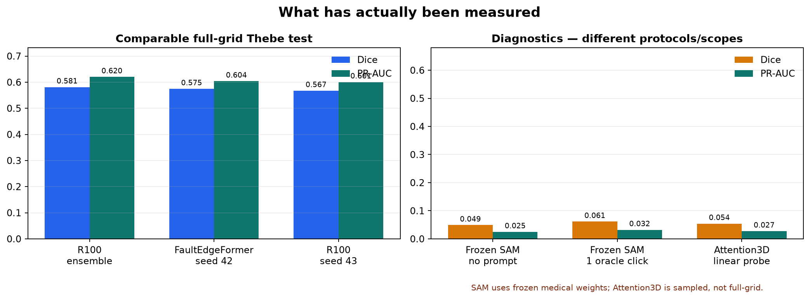

# Fault-detection experiment status, evidence, and next-run decision

**Snapshot:** 2026-10-30 16:55 +04  
**Project:** Thebe fault segmentation with Opunake/Kahu auxiliary field data  
**Primary local protocol:** pooled voxel metrics on `finite & raw seismic != 0`, complete non-overlapping Thebe grids, validation-selected checkpoint and threshold  
**Visual dashboard:** [open the HTML dashboard](dashboard.html)  
**3D dataset viewer:** [open the live viewer](http://192.168.128.145:5174/) and search for `VIS PREVIEW`

## Executive decision

The best verified, directly comparable local test result is **R100 three-seed ensemble Dice 0.581257**, not 0.56. The best single model is the local FaultEdgeFormer-inspired seed-42 run at **0.574603**. A five-seed R100 ensemble reaches **0.597311 on validation only** and has not been frozen and run on test.

The correct next sequence is:

1. finish the active SAM adapter and judge it on complete validation only;
2. finalize one canonical full-grid evaluator and mask policy;
3. measure existing five-seed R100 inference improvements on validation: overlap/Gaussian blending, then TTA as a separate factor;
4. cross-fit a heterogeneous validation fusion of R100-5 and FaultEdgeFormer;
5. freeze one protocol and run test once;
6. then run a **matched SwinUNETR-from-scratch control**; add SimMIM pretraining only if scratch is stable and competitive.

Do not restart one of the failed Attention3D jobs unchanged. Do not compare local pooled Dice directly with published OIS/ODS scores.



## Status legend

| Status | Meaning |
|---|---|
| **Complete + tested** | Training/evaluation finished and held-out test was scored. |
| **Complete, validation only** | Training or analysis finished; no new held-out test score. |
| **Active** | A process is running now. |
| **Stopped / incomplete** | A planned run ended early, diverged, or became numerically invalid. |
| **Setup only** | Code/configuration is launchable, but a required full run has not begun. |
| **Not implemented** | A paper idea or roadmap item exists, but no launch-ready local experiment exists. |
| **Superseded** | An early failed/smoke run was replaced by a later valid run. |

## Master experiment table

| Experiment | Status | Scope | Best trustworthy result | What remains | Evidence and visual |
|---|---|---|---|---|---|
| R100 seeds 42/43/44 + equal-probability ensemble | **Complete + tested** | Complete Thebe validation and seven-block test; 2.303B scored test voxels | Ensemble test Dice **0.581257**, PR-AUC **0.620308**, MCC **0.573795** | Preserve as frozen reference; do not retrain just to rerun it | [report](../evaluation/r100_clean_frozen_test_20261019/report.md), [metrics](../evaluation/r100_clean_frozen_test_20261019/final_metrics.json), [leaderboard](assets/test_leaderboard.png), [patch distribution](assets/r100_patch_distribution.png) |
| R100 five-seed ensemble curve, seeds 42–46 | **Complete, validation only** | Cached full validation probabilities | Five-model validation Dice **0.597311**; +0.008360 versus historical three-model validation ensemble | Freeze overlap/blending/TTA rule, then one test run | [report](../evaluation/r100_seed_curve_5models_20261019/report.md), [curve](../evaluation/r100_seed_curve_5models_20261019/curve.png), [analysis JSON](../evaluation/r100_seed_curve_5models_20261019/curve.json) |
| FaultEdgeFormer-inspired seed 42 | **Complete + tested** | Complete Thebe grid, same mask/population as R100 | Test Dice **0.574603**, PR-AUC **0.603953**, MCC **0.564939** | Cache complete validation logits for heterogeneous fusion; more seeds only if fusion is promising | [report](../evaluation/faultedgeformer_thebe_full_seed42_20261026/report.md), [metrics](../evaluation/faultedgeformer_thebe_full_seed42_20261026/result.json), [leaderboard](assets/test_leaderboard.png) |
| Frozen SAM-Med3D-Turbo | **Complete + tested; negative control** | Complete Thebe grid; no training | No-prompt test Dice **0.048805**; one oracle click **0.061343** | None. It proves frozen medical features do not transfer automatically | [report](../evaluation/sammed3d_frozen_thebe_20261016T011856768228130Z/report.md), [leaderboard](assets/test_leaderboard.png) |
| SAM-Med3D interactive diagnostic | **Complete, validation only** | Label-assisted crops/clicks; not automatic whole-volume inference | Best five-click calibrated validation Dice **0.174908** | Keep as interaction diagnostic only | [report](../evaluation/sammed3d_interactive_validation_20261016T075908820714115Z/report.md) |
| SAM-Med3D seismic adapter seed 42 | **Active** | 100 epochs planned; 360 train patches/epoch; fixed 128-patch validation; complete validation at end | At snapshot: epoch 47 complete, best subset PR-AUC **0.229340** at epoch 47; Dice @ 0.5 is unstable | Finish; run automatic complete validation; test only if a predeclared validation gate is met | [live training plot](assets/sam_training_progress.png), [history](../../runs/sammed3d_thebe_full_seed42_20261030/history.csv), [config](../../runs/sammed3d_thebe_full_seed42_20261030/run_config.json), [log](../training/sammed3d_thebe_full_seed42_20261030.log) |
| Attention3D Opunake+Kahu Gaussian-denoising pretraining | **Complete** | 50 epochs, 17,600 unique 64³ cubes; no Thebe/test during pretraining | Fixed-val MSE **0.009861** versus noisy identity **0.031931** | Treat only as reconstruction evidence | [report](../evaluation/attention3d_two_survey_pretext_seed42_20261026/report.md), [result](../evaluation/attention3d_two_survey_pretext_seed42_20261026/result.json) |
| Attention3D frozen-backbone Thebe linear probe | **Complete + sampled test; negative control** | 177 trainable parameters; sampled 64³ cubes, not full grid | Sampled test Dice **0.054170**, PR-AUC **0.027396**, ROC-AUC **0.509454** | Do not promote to leaderboard; only corrected end-to-end tuning can answer transfer value | [comparison](../evaluation/attention3d_faultedgeformer_comparison_20261028/report.md), [leaderboard](assets/test_leaderboard.png) |
| Attention3D imported FP16 supervised | **Stopped / incomplete** | 77 complete epochs plus a partial epoch 78; test not run | Peak validation Dice **0.539** at epoch 70, but train/val loss became NaN from epoch 74 | Do not resume; numerical validity is broken | [training plot](assets/attention3d_training_status.png), [history](../../runs/paper_attention3d_thebe_supervised_seed42/history.csv) |
| Attention3D imported BF16 clean | **Stopped / incomplete** | 65 complete epochs plus partial epoch 66; test not run | Peak validation Dice about **0.310** at epoch 61; finite through epoch 65 | Do not call complete; redesign protocol before rerun | [training plot](assets/attention3d_training_status.png), [history](../../runs/paper_attention3d_thebe_supervised_seed42_bf16_clean/history.csv) |
| Attention3D Opunake+Kahu pretrained end-to-end Thebe | **Stopped / incomplete** | 12/100 epochs; test not run | Best validation Dice **0.047885** at epoch 1; Dice collapsed to zero from epoch 4 | Replace with corrected v2; never resume this checkpoint | [training plot](assets/attention3d_training_status.png), [history](../../runs/attention3d_opunake_kahu_e2e_thebe_seed42_20261028/history.csv) |
| Initial Attention3D denoising pilot | **Superseded** | Early validation-patch failure | No valid result | Replaced by completed two-survey v2 run | [failed state](../../runs/attention3d_denoising_pilot_20261019/state.json), [replacement state](../../runs/attention3d_denoising_pilot_20261019_v2/state.json) |
| R100 matched-900 short pilot | **Complete, validation-only pilot** | 10 epochs, 90 patches/epoch | Ranking improved but Dice @ 0.5 remained zero; not equivalent to the 100-epoch R100 | No test; use only as budget diagnostic | [status](../../runs/r100_thebe_matched900_seed42_20261026/status.json), [history](../../runs/r100_thebe_matched900_seed42_20261026/history.csv) |
| Synthetic FaultSeg3D BCE/Dice and P1 CAFT studies | **Complete, synthetic only** | FaultSeg3D synthetic validation/test, not Thebe target-domain training | High synthetic validation scores are not Thebe results | Retain as historical ablations; repeat loss/sampling factors on real Thebe | [historical visual](assets/historical_zero_shot_example.png), [Baseline A report](../2026-10-02_baseline_A_report.md) |
| Thebe/Kahu/Opunake visual previews | **Complete** | Downsampled qualitative copies; no test split uploaded | Six volumes render in the 3D viewer | Add model probability volumes only after evaluation is frozen | [dataset visual](assets/dataset_overview.png), [preview manifest](../../data/processed/viewer_previews/manifest.json), [live viewer](http://192.168.128.145:5174/) |

## Setup finalized but not trained versus not implemented

There is currently **no untouched launch-ready full training job** whose setup is complete and which has never been exercised. SAM moved from setup-only to active; all existing Attention3D trainers were exercised and exposed problems.

| Candidate | Actual readiness | Category | Required before launch |
|---|---|---|---|
| R100 five-seed frozen test | Validation probabilities and analysis exist; test choice not frozen | **Setup mostly complete, test not run** | Compare overlap/Gaussian blending and TTA on validation; freeze one manifest |
| R100 + FaultEdgeFormer probability fusion | Concept and trained components exist; matched FEF probability cache and fusion script do not | **Not finalized** | Cache matched validation logits; implement cross-fitted convex/calibrated-logit fusion |
| Corrected Attention3D v2 | Pretrained checkpoint and failed-run evidence exist; corrected trainer is not implemented | **Not finalized** | Gradual unfreezing, layerwise LR, unified focal loss, fault-aware sampling, clipping, full-grid evaluator |
| Matched SwinUNETR-from-scratch control | No local trainer/config/checkpoint | **Not implemented** | MONAI or local model, patch/mask parity, memory smoke test, same evaluator |
| FaultSeg SwinUNETR + SimMIM | Paper design exists; no author code or local pretraining pipeline found | **Not implemented** | First establish scratch SwinUNETR; then masked-volume pretraining as a separate factor |
| 3D nnU-Net baseline | No converted dataset/config/run | **Not implemented** | Export split while preserving validity mask; fixed evaluator adapter |
| Plain 2.5D U-Net | No local training run | **Not implemented** | 1/3/5/7-slice context ablation with center-slice targets |
| FaultSSL | Paper and author repository exist; no local mean-teacher pipeline | **Not implemented** | Decide label-scarcity or cross-survey objective; panning/patching consistency |
| TopSUMseg / topology-aware hybrid | Paper exists; no verified local implementation | **Not implemented** | Reproduce architecture or isolate one structural loss first |
| Unified structural evaluation | Dice/PR-AUC/MCC exist; distance/continuity suite does not | **Not finalized** | Chamfer, modified Hausdorff, connected components, calibration and fixed visual sections |

## Why SwinUNETR has not been run—and whether it should be

It **should** be run, but as a matched control, not as a replacement for protocol cleanup.

Reasons it was not first:

1. **Architecture alone is not a guarantee.** The seismic FaultSeg SwinUNETR study reports standard SwinUNETR below its task-specific multi-decoder variant; TopSUMseg also reports that standard SwinUNETR trails its Swin–Mamba–structural design. This suggests the useful factors may be fault-scale supervision, structural continuity, or pretraining—not merely swapping convolutions for shifted-window attention.
2. **It is much larger.** The published standard SwinUNETR is about 61.9M parameters and FaultSeg SwinUNETR about 101.1M, versus approximately 1.46M for local R100 and 1.39M for local FaultEdgeFormer. That is roughly 42× and 73× the local models, respectively.
3. **Published numbers are not directly comparable.** Published Thebe OIS/ODS optimize/aggregate slice thresholds differently from the local pooled full-volume Dice over a fixed validity mask.
4. **The evaluator and inference controls still contain inexpensive information.** Five-seed validation already gained +0.00836 over the historical three-model ensemble without new architecture training.
5. **Domain-specific pretraining must be isolated.** The local Gaussian-denoising Attention3D transfer failed as a linear probe. That does not disprove SimMIM, but it shows that “field pretraining” is not automatically useful.

Recommended Swin experiment:

| Arm | Initialization | Architecture | Purpose |
|---|---|---|---|
| S0 | Random | Standard SwinUNETR | Architecture-only control |
| S1 | Random | Fault-scale multi-decoder SwinUNETR | Test the seismic-specific decoder independently |
| S2 | SimMIM on Thebe **training region only** | Same as S1 | Test target-domain masked pretraining |
| S3, optional | SimMIM on Thebe train + audited Opunake/Kahu | Same as S1 | Test whether cross-survey unlabeled data helps or hurts |

Use the identical Thebe split, validity mask, 128³ patch budget, threshold selection, full-grid validation, and three seeds for survivors. Only S0 should be launched initially. Promote an arm only if it improves both validation halves and does not trade away PR-AUC/MCC or continuity.

Primary sources: [Swin UNETR](https://arxiv.org/abs/2201.01266), [FaultSeg SwinUNETR](https://www.mdpi.com/2072-4292/16/5/922), and [TopSUMseg](https://journals.sagepub.com/doi/full/10.3233/FAIA250865).

## Recommended joint experiment to improve beyond the current result

### J0 — validation-only heterogeneous fusion

Use already trained models before building a new giant model.

1. Produce matched complete-validation logits for:
   - R100 five-seed mean;
   - FaultEdgeFormer seed 42;
   - SAM adapter only if its complete-validation PR-AUC passes a predeclared gate;
   - later, SwinUNETR S0/S1 if competitive.
2. Compare:
   - equal probability mean;
   - non-negative convex probability weights summing to one;
   - temperature-calibrated logit fusion with constrained non-negative weights.
3. Split validation into val1 and val2. Fit weights/temperature/threshold on val1 and score val2, then reverse. Include a component only if it improves both directions.
4. Suggested gate: at least **+0.005 Dice in both directions**, with no material decline in PR-AUC, MCC, precision/recall balance, or structural continuity.
5. Freeze model hashes, weights, temperatures, threshold, overlap, blending, TTA, validity mask, and coverage before test.

This is the most defensible short route above 0.581 because R100 and FaultEdgeFormer already show different precision/recall behavior. Complementarity must be measured, not assumed.

### J1 — controlled joint student training

If J0 proves complementary errors, train a deployable student:

\[
L = L_{supervised} + \lambda_d L_{consensus\ distill} + \lambda_c L_{panning/patching\ consistency}
\]

- **Teachers:** frozen R100-5 ensemble and FaultEdgeFormer.
- **Student:** start with the small R100/nnU-Net-style CNN; use SwinUNETR only as a separate student comparison.
- **Supervised loss:** masked BCE + soft Dice or unified focal loss, selected in a real-Thebe ablation.
- **Distillation:** use only voxels where teachers agree and predictive entropy is low; never force disagreement regions into pseudo-ground-truth.
- **Consistency:** FaultSSL-style panning consistency for overlapping views and patching consistency for full-versus-crop predictions.
- **Ablation arms:** supervised; +distillation; +consistency; +both. Structural loss is a later isolated arm.

[FaultSSL](https://arxiv.org/abs/2309.02930) provides the seismic-specific consistency rationale. The [large-scale 200+ model benchmark](https://arxiv.org/abs/2505.08585) is the strongest warning that domain shift, training strategy, and evaluation rules matter as much as architecture.

## Ranked queue

| Rank | Action | New training? | Expected information per cost | Go/no-go rule |
|---:|---|---:|---|---|
| 1 | Finish SAM and complete validation | Already running | High; resolves current active work | No test unless complete-val ranking is competitive enough to add to fusion |
| 2 | Canonical evaluator + frozen manifest | No | Essential | Exact mask/coverage reproduction across R100 and FEF |
| 3 | R100-5 overlap/Gaussian blending; TTA separately | No | Very high | Select only on complete validation |
| 4 | R100-5 + FEF cross-fitted fusion | No | Very high | +0.005 Dice on both validation directions with guardrails |
| 5 | Real-Thebe R100 loss/sampling ablation | Yes, cheap/moderate | Very high | BCE → BCE+Dice → +foreground sampling; one factor at a time |
| 6 | SwinUNETR S0 from scratch | Yes, expensive | High scientific value | Same budget/mask/evaluator; initially one seed, then three if promising |
| 7 | Plain 2.5D 1/3/5/7-slice U-Net | Yes, moderate | High | Larger in-plane context must improve both halves |
| 8 | 3D nnU-Net baseline | Yes, moderate/high | High baseline value | Preserve local mask and split; no silent defaults |
| 9 | Swin multi-decoder + SimMIM | Yes, expensive | Medium/high | Only after S0 and scratch decoder ablation |
| 10 | Joint student distillation + FaultSSL consistency | Yes, high | High research value | Only after J0 demonstrates teacher complementarity |
| 11 | Corrected Attention3D v2 | Yes, high/risky | Medium | Do not resume old runs; require stable matched pilot first |
| 12 | TopSUMseg/structural loss | Yes, high | Medium/publishable | Add one structural factor at a time and score distance/continuity |

## Worldwide/objective interpretation

The project currently establishes **in-domain Thebe performance**, not worldwide field generalization. A globally credible claim needs:

- at least one additional field survey with blinded expert fault labels;
- a survey-level split with no spatial leakage;
- calibration and uncertainty, not only Dice;
- Dice, PR-AUC, MCC, bidirectional Chamfer, modified Hausdorff, continuity/components, runtime, memory and coverage;
- multiple seeds and confidence intervals or hierarchical bootstrap by spatial block;
- fixed qualitative sections reviewed without revealing the model identity;
- exact checkpoint/evaluator/mask hashes.

Kahu and Opunake currently provide useful unlabeled pretraining and qualitative deployment data, but they cannot measure generalization until expert labels or a carefully blinded annotation subset exist.

Recent methods worth tracking are [FaultSeg SwinUNETR](https://www.mdpi.com/2072-4292/16/5/922), [FaultSSL](https://arxiv.org/abs/2309.02930), [Seismic Fault SAM](https://arxiv.org/html/2407.14121v1), [FaultEdgeFormer](https://doi.org/10.1093/jge/gxag041), and [TopSUMseg](https://journals.sagepub.com/doi/full/10.3233/FAIA250865). Their headline OIS/ODS or qualitative field results are hypotheses to reproduce, not scores to paste beside local pooled Dice.

## Visual index

- [Comparable test leaderboard](assets/test_leaderboard.png)
- [R100 test patch distribution](assets/r100_patch_distribution.png)
- [R100 five-seed validation curve](../evaluation/r100_seed_curve_5models_20261019/curve.png)
- [Live SAM adapter training](assets/sam_training_progress.png)
- [Incomplete Attention3D histories](assets/attention3d_training_status.png)
- [Historical zero-shot prediction example](assets/historical_zero_shot_example.png)
- [Dataset preview gallery](assets/dataset_overview.png)
- [Interactive 3D viewer](http://192.168.128.145:5174/)

## Rebuild commands

```bash
cd /shared/home/khavarj/projects/fault_detection
.venv_train/bin/python scripts/build_experiment_status_visuals.py
.venv_train/bin/python scripts/export_viewer_previews.py
```

The plotting environment received `matplotlib` only; model-training code, checkpoints, and active process state were not changed.
