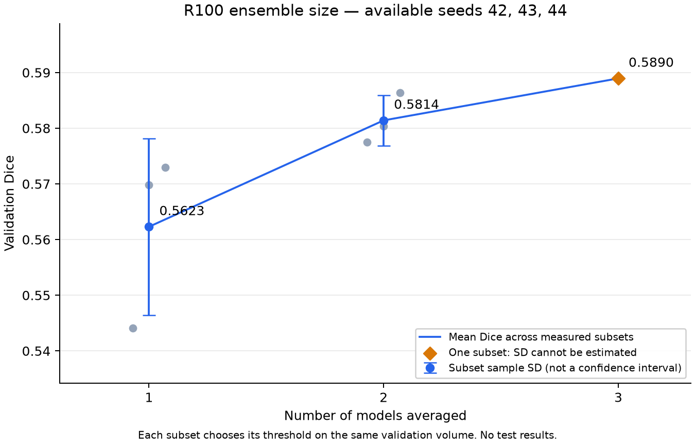

# Extra R100 seeds: measured baseline and proposed pilot

## What this experiment measures

The question is whether averaging additional independently trained R100 models improves validation Dice enough to justify their training cost. Change only the random seed. Keep the architecture, real Thebe training data, normalization, sampler, loss, 100-epoch budget, and checkpoint-selection rule fixed.

The initial measurement is complete. The two-seed pilot was **launched on 19 October 2026** after authorization: seed 45, then seed 46, each for 100 epochs. Validation caching, the five-model comparison, and plotting run automatically afterward. See the [live pipeline state](../../runs/R100_seed_saturation_pilot_20261019/pipeline_state.json), [training queue state](../../runs/R100_seed_saturation_pilot_20261019/queue_status.json), and [seed 45 log](../../runs/R100_seed_saturation_pilot_20261019/seed45.log). These files are authoritative for current progress.

## Names checked against the directory

| Name | What actually happened |
|---|---|
| Baseline A | Small U-Net trained on synthetic FaultSeg3D. |
| Clean R100 seeds 42–44 | Small U-Net trained **from scratch on real Thebe**, using ordinary BCE. These are the members of this seed-count study. |
| Fine-tuning | Starting from previously learned weights and adapting them. The clean R100 trainer does not do this. |
| Original resumed R100 seed 42 | Historical run with a changed resume protocol. Keep separate from the clean seed pool. |
| P1 / imported paper attention / SAM-Med3D | Different model or training experiments. They are not extra members of the identical-recipe seed pool. |

The existing best checkpoints are from epochs 95, 93, and 95. Each training directory contains only `best.pt` and `last.pt`; it does not contain a collection of earlier good checkpoints.

## What the existing three seeds show

We cached full-validation probabilities once per seed and reproduced all eight original member/ensemble histograms exactly. The analysis then scored **every** available subset: three singles, three pairs, and one triple. Each subset selected its own threshold on full validation.

| Models averaged | Combinations | Mean validation Dice | SD among combinations |
|---|---:|---:|---:|
| 1 | 3 | 0.562302 | 0.015865 |
| 2 | 3 | 0.581409 | 0.004551 |
| 3 | 1 | 0.588951 | Cannot estimate from one combination |

Mean Dice rises by 0.019107 from one to two models, then by 0.007542 from two to three. That is consistent with a smaller marginal gain in this pool. It does not establish where a larger seed pool saturates or forecast the performance of 40 seeds.



Error bars describe which combinations were selected from the available models. They are **not confidence intervals across surveys**. The combinations share models, and their scores are correlated. Also, these thresholds were selected on the same validation volume being scored, so these are apparent validation results, not new held-out estimates.

[Detailed results](../evaluation/r100_seed_curve_3models_20261019/report.md) · [Exact numbers and subsets](../evaluation/r100_seed_curve_3models_20261019/curve.json)

## Corrections to the proposed reasoning

- **Do not assume a universal 5–10-model plateau or a +0.01 to +0.02 Dice gain.** Deep-ensemble research supports measuring ensemble size, but its benchmark outcomes do not determine this dataset's Dice curve. [Deep Ensembles, 2017](https://arxiv.org/html/1612.01474v3).
- **More members do not remove every shared error.** Whether averaging improves Dice depends on prediction quality, error diversity, calibration, and the chosen threshold. It is not a guarantee of a fixed variance-only gain.
- **Subset analysis avoids model inference, not all computation.** It still reads cached arrays, averages them, and builds metric counts. Our implementation reads each probability block once and reuses it for the selected subsets.
- **A running mean is enough for one fixed ensemble.** To measure arbitrary subsets later, retain each member's map on disk. The cache stores FP32 probabilities to preserve the frozen results rather than introducing FP16 storage rounding.
- **Snapshot prediction averaging and SWA are different.** Snapshot Ensembles uses saved models along a designed training trajectory, often with cyclic learning rates. SWA averages model weights along a training trajectory. The current two saved checkpoints per run do not recreate a historical snapshot collection. [Snapshot Ensembles, 2017](https://arxiv.org/abs/1704.00109), [SWA, 2018](https://arxiv.org/abs/1803.05407).
- **Flip TTA and varied recipes are separate experiments.** TTA averages predictions of transformed inputs after transforming outputs back. It creates no independent training seeds, and valid flips need seismic justification. Different losses, patch sizes, or augmentation would change more than seed count; they may help, but no ordering such as five varied models beating twenty identical-recipe seeds is established here.
- **0.002 is a practical decision threshold, not a statistical test.** Predefine comparisons such as 3 versus 5, then 5 versus 8/10. Recompute the size curve using the same available pool; a three-model mean from five seeds is a different statistic from the one fixed original triple.

## Measured costs and storage

The original epoch histories total 5.125, 5.191, and 5.019 hours per seed, averaging about **5.11 hours**. These are observed training times, not a guarantee for another run.

| Total desired members | Extra seeds beyond the existing three | Approximate additional training |
|---|---:|---:|
| 5 | 2 | 10.2 hours |
| 10 | 7 | 35.8 hours |
| 40 | 37 | 189 hours, about 7.9 days |

Inference wall time should not be extrapolated by simply multiplying the entire previous duration by 40/3. Reading and preprocessing can be shared; model calls scale with member count, but total wall time also includes other costs. Measure it if larger ensembles are justified.

Full validation contains 613,738,550 scored voxels. FP32 probability storage is about 2.45 GB per seed, plus a shared 0.61 GB label file: about 8 GB for three seeds or 25 GB for ten. The initial cache uses approximately 7.43 GiB. It contains validation data only.

## Files and commands

| File | Purpose |
|---|---|
| [cache_r100_validation.py](../../scripts/cache_r100_validation.py) | Run validation inference once per new member and cache its probabilities. Verify the frozen recipe and metrics. |
| [analyze_r100_seed_curve.py](../../scripts/analyze_r100_seed_curve.py) | Measure subsets from cached maps without loading models or seismic HDF5 files. |
| [run_r100_additional_seeds.py](../../scripts/run_r100_additional_seeds.py) | Train extra seeds with the unchanged trainer. Supports preparing a plan without training and resuming an interrupted queue. |
| [test_r100_seed_curve.py](../../tests/test_r100_seed_curve.py) | Six synthetic tests of subset selection, streaming averages, thresholds, variation reporting, and corrupted-cache rejection. |
| [Pilot plan](../../runs/R100_seed_saturation_pilot_20261019/plan.json) | Authorized seeds 45 and 46. Check live state for completed epochs; the plan alone is not evidence of trained models. |
| [run_r100_seed_pilot.py](../../scripts/run_r100_seed_pilot.py) | Automatically runs training, validation caching, subset analysis, plotting, and a summary of the measured gain. |

The existing cache is `data/cache/r100_seed_saturation_20261019/`. Its manifest records probability/label checksums, checkpoint checksums, tile ordering, and exact-validation checks. Completed cached members are reused; a new member can be added later without regenerating the old predictions.

Run commands from `/home/khavarj/projects/fault_detection`.

The automatic pipeline already executes the following training step. These individual commands are retained as a reference; **do not start a duplicate while the pilot is running**:

```bash
.venv_train/bin/python -u scripts/run_r100_additional_seeds.py \
  --run-root runs/R100_seed_saturation_pilot_20261019 \
  --seeds 45 46 --resume-queue
```

After both seeds finish and pass the original training gate, cache only the new members:

```bash
.venv_train/bin/python -u scripts/cache_r100_validation.py \
  --cache-dir data/cache/r100_seed_saturation_20261019 \
  --run-dirs runs/R100_seed_saturation_pilot_20261019/seed45 \
             runs/R100_seed_saturation_pilot_20261019/seed46
```

Then measure all subsets at sizes 1, 2, 3, and 5:

```bash
.venv_train/bin/python -u scripts/analyze_r100_seed_curve.py \
  --cache-dir data/cache/r100_seed_saturation_20261019 \
  --output-dir reports/evaluation/r100_seed_curve_5models_20261019 \
  --sizes 1 2 3 5
```

For larger pools, the analyzer exhausts small combination sets and otherwise samples up to 32 unique subsets per size using a fixed random seed. This cap is configurable and recorded. Results should be interpreted as conditional on the available seed pool.

The study does not open test HDF5 files. The existing test split has already been evaluated in the project; a later selected-ensemble test must be reported as a separate frozen follow-up, not described as a completely untouched research holdout.

## Automatic pilot outputs

The background pipeline writes progress to `runs/R100_seed_saturation_pilot_20261019/pipeline_state.json`. Detailed training progress is in `seed45.log` and later `seed46.log` in that directory. It stops if a stage fails, preserving logs for inspection.

After successful training, final measurements will be written to `reports/evaluation/r100_seed_curve_5models_20261019/`. The output `pilot_summary.json` will report both the gain over the original fixed three-model ensemble and the gain over mean three-model subsets from the same five-seed pool. A 0.002 reference is recorded as a practical budget criterion; it is not a significance test.

The pipeline runs independently of this chat, trains no seeds beyond 46, and does not evaluate the test split. Launch source snapshots and checks are saved in the pilot run directory.
